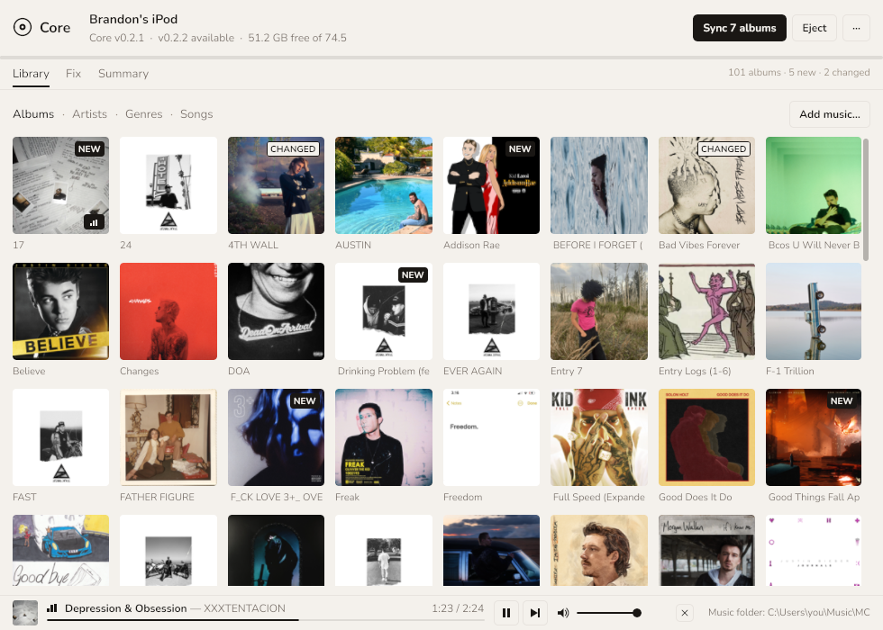
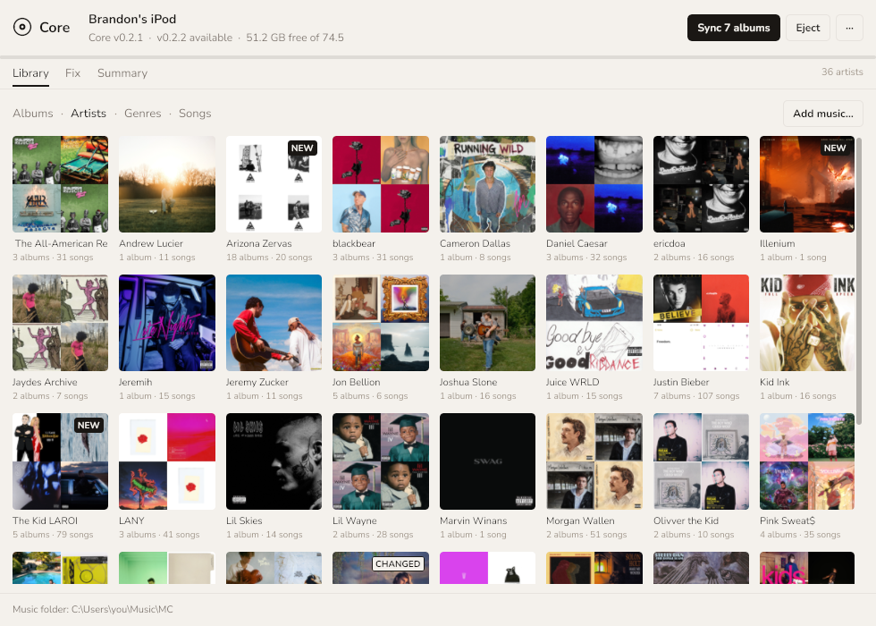

# core desktop app — `core` and `core-app`

The host side of [Core](https://github.com/BrandonDedolph/core-firmware), a from-scratch
firmware for the iPod Video 5G/5.5G. Two executables from one Go module run the whole
everyday-user loop: put music on the iPod in the layout the firmware expects, bake the album-art
sidecars, write the index, flash the firmware, fetch updates — and keep the music folder itself
in order.

- **`core`** is the CLI. Console subsystem, cobra, one subcommand per job:
  `info`, `backup`, `firmware`, `index`, `art`, `organize`, `fix`, `add`, `sync`, `eject`, `name`,
  `config`, `install`, `flash`, `update`, `self-update`, `doctor`.
- **`core-app`** is the desktop window (Gio v0.8.0). It finds the iPod by itself — a 2-second
  poll, so plugging one in is the whole gesture — and stops for exactly one thing: an iPod still
  running Apple's firmware, which gets a single screen and an **Install Core** button. Once Core
  is on it: a header with the iPod's name, firmware, free space and one verb-first button;
  **Library** (your music folder as Albums, Artists, Genres and Songs, with *Add music…*), **Fix**
  (the music folder and what is wrong with it) and **Summary** (the iPod in seven rows and an
  Advanced disclosure); a player; the log as a drawer on every screen, with the iPod's own log
  beside it; and a "···" menu with Settings… and the app's own updater. Linen and Onyx, the
  device's palettes, in Nunito. It links the same internal packages as the CLI directly — no
  server, no IPC. On Windows its embedded manifest asks for Administrator at launch (one UAC
  prompt), so it reads the disk and flashes in-process; if it is somehow running unelevated it
  runs the `core` CLI beside it under UAC.

<p align="center"></p>
<p align="center"></p>

How to use both is in **[docs/GUIDE.md](docs/GUIDE.md)**; the rest of the repository's writing
is under **[docs/](docs/)**:

| | |
|---|---|
| [docs/GUIDE.md](docs/GUIDE.md) | the user guide: the window, tab by tab, and every `core` command |
| [docs/BUILD.md](docs/BUILD.md) | building `core` and `core-app` on each platform, the `novulkan` and `noaudio` tags, rendering the window headless, the tests and the parity environment variables |
| [docs/ARCHITECTURE.md](docs/ARCHITECTURE.md) | the package layout, the write path and its safety checklist, device detection, elevation, and the design notes |
| [docs/STATUS.md](docs/STATUS.md) | every command, and what is behind it |
| [docs/RELEASING.md](docs/RELEASING.md) | versions, which firmware the app writes for, the update checks and cutting a release |
| [docs/screens/](docs/screens/README.md) | the screenshots, and how they are shot |
| [docs/design/](docs/design/) | the plans the work was done from (`companion-app-plan.md`, `library-manager-plan.md`, `app-ux-pass-plan.md`, `settings-plan.md`, `library-plan.md`) |
| [CHANGELOG.md](CHANGELOG.md) | what each release changed |

*Why two executables and not `core ui`:* an exe linked with `-H windowsgui` has no console at
all, so `core sync` typed in a terminal would print nothing; an exe linked without it flashes a
black console every time the app starts. Two files avoid both.

## Download

From this repository's [releases page](https://github.com/BrandonDedolph/core-desktop-app/releases):
`core-{os}-{arch}` and `core-app-{os}-{arch}` for Windows (amd64), macOS (arm64, amd64) and Linux
(amd64, arm64). Put the two in the same folder. On macOS and Linux, `chmod +x` them. Once
installed, the app updates itself: ··· → *Update the app*, or `core self-update`.

## Core firmware, and which versions go together

The firmware is [BrandonDedolph/core-firmware](https://github.com/BrandonDedolph/core-firmware),
a separate repository with its own `v…` tags and releases, each carrying one asset, `core.ipod`.
This repository never ships firmware; it writes the files that firmware reads (`CORELIB.IDX`,
`folder.art`/`folder.thm`, `CORECFG.DAT`, `CORELOG.BIN`, `COREOTG.DAT`, the playlists) and
flashes the image.

- **`core update`, Install and Update** read core-firmware's releases: the newest published `v…`
  release that carries `core.ipod`. `--repo owner/name` points them elsewhere.
- **The MinFirmware rule.** `app.MinFirmware` (`v0.2.0`, a core-firmware tag) is the oldest
  firmware whose file formats this app writes. On an iPod with older firmware the app says so,
  offers Update first, and a real sync refuses. It is raised when a firmware release changes
  one of those formats.
- **A newer app** is looked for in this repository's releases once per launch; see
  [docs/RELEASING.md](docs/RELEASING.md).

## Build

Go 1.22.10 (`.tool-versions`), from the repository root:

```bash
go build -o core ./cmd/core                       # the CLI, pure Go, cross-compiles anywhere
go build -tags novulkan -o core-app ./cmd/core-app   # the window (Linux; see BUILD.md for Windows and macOS)
go test -tags noaudio ./...                        # never opens an audio device
```

Cross-builds, the `novulkan` and `noaudio` tags, `--screenshot`, the parity tests and CI are in
[docs/BUILD.md](docs/BUILD.md).

## Licence

Apache-2.0 ([`LICENSE`](LICENSE)), like the firmware.
Nunito (OFL 1.1) is embedded in `core-app`; its licence is in
`internal/app/fonts/OFL.txt`.

`core-app` links these for the album sheet's player, each under the licence
its LICENSE file states:

| Module | Version | Licence |
|---|---|---|
| `github.com/ebitengine/oto/v3` | v3.3.3 | Apache License 2.0 |
| `github.com/ebitengine/purego` (oto's, macOS only) | v0.8.0 | Apache License 2.0 |
| `github.com/hajimehoshi/go-mp3` | v0.3.4 | Apache License 2.0 |
| `github.com/mewkiz/flac` | v1.0.12 | The Unlicense (public domain dedication) |
| `github.com/mewkiz/pkg` (flac's) | 2023-02-26 | The Unlicense (public domain dedication) |
| `github.com/icza/bitio` (flac's) | v1.1.0 | Apache License 2.0 |

They are the newest releases whose `go.mod` accepts the Go 1.22.10 this
module is pinned to: oto v3.4+ asks for Go 1.24 and mewkiz/flac v1.0.13+
for Go 1.23.
