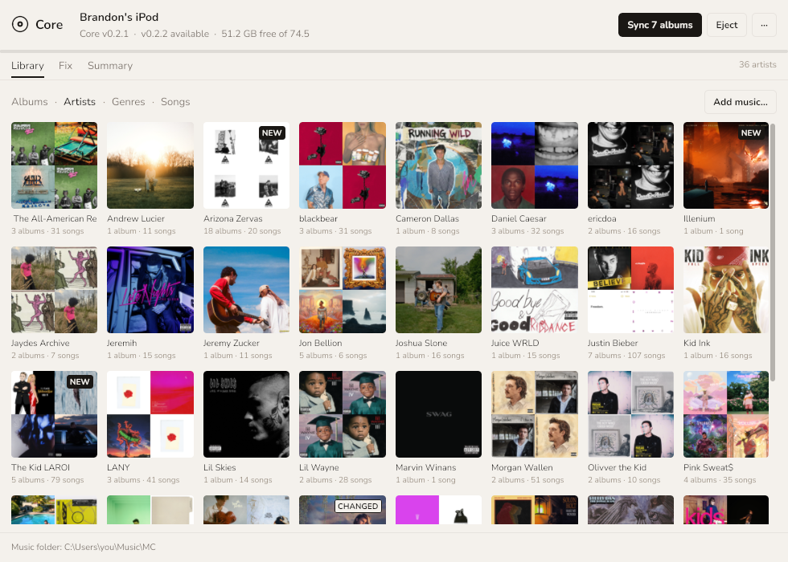
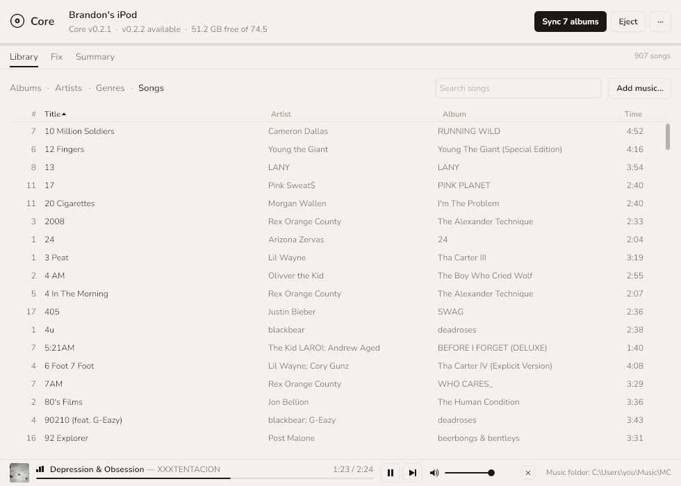

# The `core` app

This is the guide to the host side: the `core` command line and the `core-app` window. The guide
to the iPod itself — the controls, browsing, Now Playing, Settings, themes, battery and recovery —
is the firmware's
[user guide](https://github.com/BrandonDedolph/core-firmware/blob/main/docs/USER_GUIDE.md).

`core` is one program for your computer that does the host side: it puts the music on the iPod in
the layout the firmware reads, bakes the album art, writes the index, and flashes firmware. One
file, no installer.

Download the one for your machine from this repository's
[releases page](https://github.com/BrandonDedolph/core-desktop-app/releases) — every release carries
the app and the command line. The firmware itself (`core.ipod`) is released from
[core-firmware](https://github.com/BrandonDedolph/core-firmware/releases), and `core update` fetches
it from there:

| File | For |
|---|---|
| `core-windows-amd64.exe` | Windows |
| `core-darwin-arm64` | macOS, Apple silicon |
| `core-darwin-amd64` | macOS, Intel |
| `core-linux-amd64` | Linux, x86-64 |
| `core-linux-arm64` | Linux, ARM |

To build it yourself instead, from a checkout of this repository: `go build -o core ./cmd/core`
(see [BUILD.md](BUILD.md)). On macOS and Linux, `chmod +x` the downloaded file.
The examples below call it `core`.

**The window.** `core-app` is the same thing as a desktop application. It ships beside the command
line as `core-app-windows-amd64.exe`, `core-app-darwin-arm64`, `core-app-darwin-amd64`,
`core-app-linux-amd64` and `core-app-linux-arm64`. On Windows it asks for Administrator when it
opens (one UAC prompt), because reading the iPod's raw disk needs it; that is also what lets it
flash from the window with no second prompt. Keep `core` in the same folder anyway: a window that
is somehow not elevated runs `core.exe` under Administrator for the flash.

It finds the iPod by itself — there is nothing to press. Plug it in, in disk mode, and the window
shows it within two seconds.

- **The header** says which iPod it is (the name you gave it, and its model), the firmware on it,
  whether a newer Core is out, and how much space is free. Its one button says what it will do:
  *Sync 7 albums*, *Update to v0.2.2*, *Install Core*, or *Eject*. The window asks GitHub for the
  latest release once when it first finds the iPod, so an update is offered without you asking.
- **Music** is your music folder, in the four views the iPod's own menu has — the switch under
  the tabs reads *Albums · Artists · Genres · Songs*, and the window opens on the one you left.
  - **Albums** is the covers, with the ones that are new or changed marked. A click opens the
    album: its tracklist, and a track plays on this computer.
  - **Artists** is a tile per artist, sorted as the iPod sorts them (*The Blue Nile* under B),
    with how many albums and songs; NEW or CHANGED when any of their albums is. An album with
    tracks led by more than one artist — a compilation, a split — is under each of them; a guest
    (*feat.*, a second name in the tag) is not an artist of their own. The picture is a mosaic of
    up to four of the artist's covers (one cover alone, or their initial when there is none). A
    click opens the artist: the picture, the facts and their albums, each opening the album.
  - **Genres** is a row per genre — its artists and albums and a strip of covers — with the genre
    the iPod will show: the tag's, through the genre map a sync uses. A click shows that genre's
    albums (*‹ Genres* goes back).
  - **Songs** is every song in a table: number, title, artist, album, time and a dot for the ones
    the next sync copies (filled: new; a ring: changed). Click a column head to sort by it, again
    to reverse it; type in *Search songs* to narrow it by title, artist or album. A click plays
    the song here, and the album carries on after it.
- **Adding music.** *Add music…* — at the right of the view switch, on the empty Library tab,
  and in **···** — asks for a folder (a ripped CD, a download, a USB stick, a whole second
  library) and shows one sheet, *Adding to your library*: where it is from, what was found, and
  one row per album with the name it will get in your music folder (`Album - Artist`, from its
  tags), its songs and its size. Every album is ticked except the ones your library already has
  (the same folder, or the same songs under another name), which you may tick anyway, and the
  ones that cannot be added — no tags, no track numbers, or a format the iPod cannot play
  (`.m4a`, `.ogg`, `.wav`…) — which say why. *Add N albums* copies every file into place, reads
  each copy back and checks it against its original, and only when every file of an album checked
  out deletes the originals, and their folder if that leaves it empty; untick *Delete the
  originals once they are safely in the library* to leave the folder as it was. A copy that does
  not match leaves that album's originals alone and takes its copies away. An album with no cover
  gets the picture in its folder, or one from the internet when Settings allows it. The albums
  then show as NEW, the header says *Sync N albums*, and the Fix tab's *Undo* puts the originals
  back where they were. Nothing on the iPod changes until you sync. From the command line:
  `core add <folder> --to <music folder>` (`--keep-originals`, `--dry-run`).
- **Fix** is where the music folder is set (the field and *Browse…*), and what is wrong with
  it — filenames that do not match their tags, folders to organize, missing covers — with *Fix
  all* and *Undo*. Clicking the folder at the bottom of the window brings you here. Two more
  checks live here:
  - **Low-resolution cover art** lists albums whose cover is smaller than 600 px on its short side,
    with the cover they have beside a larger one: the cover.jpg already in the album folder when it
    is bigger, otherwise one found on iTunes (1200 px) or the Cover Art Archive. *Use this cover* or
    *Skip* each one; untick the row to leave them all. Only a larger cover is ever used, every track
    of the album gets it, the next sync copies those tracks again, and *Undo* puts the old cover
    back. (A cover file in the folder is also used, without asking the internet, for an album that
    has no cover at all.) The 600 is the *Low-resolution covers* picker in Settings… (Off, 300, 600 or
    1000 px), or `core config set min_art_px 1000` from the command line.
  - **Duplicate albums** are two album folders with the same songs in them, so the iPod has them
    twice — say an album that is also Disc 2 of its deluxe edition. Each pair is shown side by side
    with the reason; *Keep this one* moves the other folder to a `.core-trash` folder next to your
    music folder (not the Recycle Bin), and *Undo* moves it back. If the other album has songs the
    one you keep does not, the button warns and asks a second time. Empty `.core-trash` yourself
    when you are sure. *Fix all* never touches duplicates.
- **Summary** is this iPod in seven rows — Name (*Rename*), Firmware (*Update* / *Check*), Last
  boot (which firmware the iPod actually started, from its own log, so a flash that did not boot
  is caught here), Storage, Library on the iPod (*Repair*), Hardware, Backups (*Show folder*,
  *Back up now*) — and an
  *Advanced* section with the disk path, the partition entry, the device files and *Flash this
  image* for an image file of your own.
  **Library on the iPod** is the library as the iPod will read it: "907 songs · 101 albums · 17
  genres · index valid" when nothing is wrong, or what is — an album with no cover, a song in the
  index that is not on the iPod, a playlist entry that points at nothing, a settings file or log
  the iPod would refuse — one line each, up to four. *Repair* is a sync, through the same preview
  as *Sync N albums* (a sync renders the covers that are missing): the window never patches the
  iPod by hand. A problem no sync fixes — a torn On-The-Go save, a
  library over the iPod's limits — has no *Repair* and its line says what does fix it.
- **The log** is behind **···** → *Show the log* (or Ctrl+L): a drawer with two tabs. *This
  window* is everything the window did, with *Copy* and *Clear*. When a job fails, its status line
  in the header says so and opens the log when you click it. *The iPod* is the iPod's own log
  (`CORELOG.BIN`), newest start first, each start headed by the build it ran and the time its
  clock read; *Copy* copies it. It is read when you open the tab and with every refresh, never
  while a sync or a flash is writing, and nothing here changes it. The iPod saves its newest lines
  when it sleeps, switches off or goes into disk mode (and every 2 KB in between), so the last
  few lines of a start appear once it has done one of those.
  The window remembers which tab you were on until it closes.
- **···** holds the rest: back up the firmware, flash an image file, read the iPod again, check for
  updates, show or copy the log, add music, open the music folder, *Settings…* and About — and, when a newer
  release of the app is out, *Update the app to vX.Y.Z* (see **Updating the app** below).
  *Settings…* is everything the app remembers, saved the moment you change it: the music folder,
  the four *Fix all* ticks (the Fix tab's own), the low-resolution line, the backup folder, *Use
  ReplayGain*, the theme (System, Linen, Onyx — System follows Windows' dark-mode setting), and
  whether the window keeps its size and reopens on the last tab. It also holds the behaviour: a
  playlists folder, whether to look for covers on the internet (off, only a cover file in the
  album folder is used) and — off unless you tick it, and only with the internet on too — *Artist
  pictures from Deezer*, which puts Deezer's photo of an artist on their tile instead of the
  mosaic (the photos are Deezer's, for private use; they stay in the app's cache folder and are
  never put in your music folder or on the iPod), and for duplicate albums; whether a sync verifies copies by content and
  ejects the iPod when it finishes, and a genre map file of your own; how many firmware backups
  to keep (the Apple one always stays), whether to check for updates when an iPod connects and
  to include pre-releases; and a log file, opened at the next start. *Restore defaults* puts them
  back, keeping the music folder and your iPods' names. The hold to write, the backup before
  every flash and the read-back check are not settings.
- **Browse…**, wherever it is — the music folder, the Settings folders and genre map, an image to
  flash or install — opens a chooser inside the window, not a separate dialog: the folder you are
  in as a path you can click back along (*This PC › C: › Users › you › Music*), its folders (and,
  when a file is wanted, only the files of that kind) in a list, and *Choose this folder* — or
  *Choose "Name"* when a folder in the list is selected. Click once to select, again (or Enter)
  to open; Backspace or *Up* goes up, the arrow keys move, Esc or a click outside cancels. *This
  PC* lists the drives, the iPod among them. *Type a path* takes one pasted from elsewhere.
  Hidden and system folders are not listed. It opens where the field already points, or where
  you last chose for that field.

Writing firmware — Install, Update, or an image of your own — is confirmed in one dialog that says
which iPod will be written: its name, model, serial, which disk on this PC and how much is
written. On the iPod Video 5.5G 80 GB, the hardware Core has been tested on, you confirm by
**holding the button for two seconds**. Any other iPod is refused by the window; the command line
can write it with `--untested-hardware`, if you mean to take that risk. *Sync and remove* lists the albums it would delete and says how many on its button.
After any write the window reads the iPod again, so the header shows the new version at once.

Click an album to open it: its cover, what the iPod has of it, and its tracklist. Click a track to
listen to it on the computer, and the album plays on from there; the playing track shows the
iPod's bouncing bars, and *Show folder on this PC* opens the folder. *Edit…* turns the tracklist
into the album's tags in fields — album, album artist, genre and year, and each track's number,
title and artist. *Save* writes what you changed into the files in your music folder (nothing else
in them: ReplayGain, the cover and every other tag stay as they were), then renames the files and the
album folder to match, and the album shows as *changed* until the next sync copies it; *Cancel* or
Esc leaves everything as it was. The iPod is never edited directly — the sync takes the new tags
across — and *Undo* on the Fix tab puts back the old tags and the old names together. A field the
tracks disagree about (two genres on one album) opens empty and is only written if you type into it.
A track that is playing when you save it is stopped first, and the album says so. MP3 tags are written
too, but the renaming is FLAC-only, as Fix's is. The player is the bottom left
of the window, whether the album is open or not: the album's cover, the bars, the track and its
artist, the time over a line you can click to jump, pause, next and ✕ (stop). A click on the cover
or the title opens the album at that track, and the album's tile in the grid carries the bars too.
Space plays and pauses, and Ctrl+→ / Ctrl+← go to the next and previous track (not while you are typing in a
field). The app plays at the iPod's loudness: a FLAC's ReplayGain tag is
applied the way the firmware applies it (never louder than its peak allows), so albums mastered loud
sit level with quiet ones — *Use ReplayGain* in Settings turns it off. The speaker and slider beside the buttons set the app's own volume — not Windows' — and
remember it; the mouse wheel over the player or Ctrl+↑ / Ctrl+↓ nudge it, and a click on the
speaker mutes. When the album ends the bar says so for a moment and goes away. A sync or a library fix
does not stop the music; a track a fix has renamed is skipped. *Sync N albums* (and *Preview sync* on the Summary tab) first shows what the sync would do,
and why: a card with one line per kind of work — albums *new on the iPod*, albums *changed since
the last sync* (a file the iPod has an older or different copy of), tracks *renamed on the iPod*,
covers to render, playlists to write, whether the index is rewritten, and what is *on the iPod,
not in your folder* (a sync keeps it; *Sync and remove* deletes it) — then each album with how
many of its tracks go and whether it is new or changed, the total, and *Show the plan*, which is
every file and the reason it is copied, the same text `core sync --dry-run` prints. Nothing is
written until you press the sync button on it. When no music needs copying but covers, playlists
or the index do, it says *Nothing to copy* and offers *Sync* for the rest; when there is no work
at all it says *Everything is on the iPod*. The same reasons go to the log, one line per album.

<p align="center"></p>
<p align="center"></p>
<p align="center"></p>
<p align="center"></p>
<p align="center"></p>
<p align="center"></p>
<p align="center"></p>

**Connect.** Put the iPod in disk mode — Settings, Disk Mode on the device, or hold Select + Play
at power-on — plug it in, and ask what is there:

```
core info
```

That prints the disk, the logical sector size, the partition table and the firmware images, and
never writes. If it says no iPod, `core info --all-disks` lists every disk the OS can see and which
opens were refused. Reading a raw disk needs Administrator on Windows and root on Linux and macOS;
when an open is refused the error prints the exact elevated command to run.

**Music.**

```
core sync --src "C:\Users\you\Music" --dst D:\
core eject D:
```

`--dst` is the iPod's volume root, not its `Music` folder. The source is one folder per album named
`Album - Artist`, one FLAC or MP3 per track, and playlists, if you keep any, as `.m3u8` files in a
`Playlists/` folder beside the albums.

`sync` copies each track to `Music/Artist - Album/NN. Title.flac` (or `.mp3` — nothing is
converted, each file keeps its own format), writes `folder.art` and
`folder.thm` beside it from the file's embedded cover, rewrites the playlists to device paths under
`Music/Playlists/`, creates `CORECFG.DAT`, `CORELOG.BIN` and `COREOTG.DAT` in the volume root and
the five `Music/Playlists/On-The-Go N.m3u8` slots if they are missing (an existing one is never
reset, so your settings, your log and your saved lists survive), **sets the iPod's clock**, and
writes `Music/CORELIB.IDX` last — last on purpose, so the index never names files a failed copy did
not leave behind. A track already on
the device is skipped when its size matches and its timestamp is within two seconds — or exactly
an hour off, which is what every file on the iPod reads the morning after the clocks change (FAT
stores local time); `--verify` compares content instead.

```
core sync --src … --dst D:\ --dry-run       # print the whole plan, write nothing
core sync --src … --dst D:\ --prune --yes   # also remove what is on the device and not in the source
```

Nothing is deleted without `--prune --yes`.

**Settings.** The command line reads the same settings file as the window:

```
core config                          # every setting, and which are still the default
core config set min_art_px 1000      # covers under 1000 px count as low-resolution
core config set source "C:\Users\you\Music"
core config unset source             # back to the default
```

A flag always wins, then `$CORELIB_SRC`, then the file — so once `source` is set, `core sync --dst D:\`
needs no `--src`, and the command says where the folder came from before it starts. `core update
--prereleases` (and `core install --prereleases`) may pick a release candidate, as `prereleases`
in the file does; `core config set keep_backups 3` makes every flash, update and install keep the
three newest `fwpart-*` backups and remove the older ones (never `apple-*`), and `--dry-run` lists
what it would remove.

**The clock.** `sync`, `install` and `eject` all write your computer's current time (and its time
zone) into `CORECFG.DAT`, and the iPod picks it up at its **next boot**. It cannot be told the time
while it is plugged in: on the cable it is Apple's disk mode answering, not this firmware. `eject`
stamps last, immediately before the volume goes away, which is why it is the one that matters —
unplug, the iPod reboots, and the clock is seconds old. Nothing else in the file is touched: the
stamp rewrites one of its two records and copies everything else across byte for byte. `core doctor`
prints the stamp and whether the device has taken it yet.

**Firmware.**

```
core update                      # the newest release: download, verify, flash
core flash core.ipod             # a particular image, e.g. one downloaded from a release
core backup                      # the whole firmware partition to a file
core doctor                      # read-only check of the device and its library
core doctor --boot               # did the iPod start the image the last flash wrote?
```

`update` reads the latest GitHub release, downloads the image, checks it against its own checksum,
and flashes it. Writing the firmware partition needs Administrator on Windows and root on macOS and
Linux. From an ordinary console the download and the check still happen, and then the exact
elevated command is printed: a `core flash` of the downloaded file, first with `--dry-run` so you
can read the plan, then with `--yes`. On Windows, paste it into a Command Prompt opened with "Run as
administrator"; on macOS and Linux, prefix it with `sudo`. `core update` and `core doctor` ship with
the v0.1.3 binaries.

Every flash backs the whole firmware partition up first, writes only this firmware's image and the
one directory row describing it — the Apple preamble, the partition table and Apple's other images
are never touched — and re-reads what it wrote to compare. `--dry-run` prints the plan and opens
nothing for writing.

**Did it boot?** The read-back proves the bytes, not the boot. To prove the boot: unplug the iPod
and let it start, plug it back in, and run `core doctor --boot` (or look at **Last boot** on the
app's Summary tab). Every flash leaves a small note, `COREFLSH.TXT`, on the music volume: which
image it wrote and where the iPod's own log (`CORELOG.BIN`) stood at that moment. The firmware adds
to that log every time it starts, so a start newer than the note is a start of the new image.
`--boot` prints the last start and its time, the build it ran, whether the library index loaded,
and whether that session ended cleanly (sleep, standby, disk mode) or just stopped (a reset, a
crash, a flat battery). It exits 1 while the iPod has an image it has not started yet — "flashed
v0.2.2, last boot ran v0.2.1 — the iPod has not restarted since". Firmware newer than v0.2.2 also
names its own build in the log at every start, and the check believes that line over the note: it
then compares the build the iPod said it ran with the image it holds. An image written by an older
`core` or another tool has no note, so with older firmware the build is reported as unknown (a WARN,
not a FAIL).

**Updating the app.** When the window starts it asks GitHub, quietly, whether a newer release of
the app is out. If one is, About says so and **···** gains *Update the app to vX.Y.Z*. It asks once
— "It downloads vX.Y.Z, replaces this program and core.exe beside it, and restarts." — and on *Yes*
downloads this computer's `core-app` and `core` from the release (the header shows how far), checks
each against the `.sha256` file published beside it, puts them in place of the running ones and
starts the new app. On Windows a running program cannot be overwritten, only renamed, so the old
files become `core-app.old.exe` and `core.old.exe` for a moment; the next start deletes them. A
download that fails or does not match its checksum changes nothing, and the log says why. A folder
you cannot write to (Program Files without an administrator) is refused before anything is
downloaded; the log names the folder and the release page, where the files can be downloaded by
hand. From a console:

```
core self-update --check         # is there a newer app, and what would it replace?
core self-update                 # download, verify, replace core and core-app (asks first)
core self-update --yes           # without asking
```

Releases made before this (v0.3.0 and older) carry no checksum files, so they cannot be installed
this way: the update refuses a binary it cannot verify.

**What is verified.** The iPod Video 5.5G 80 GB is the only model this firmware has ever booted,
and the only one the app knows. Its flash path has been run on that device: the whole-partition
backup, the write, and the read-back all matched, and `ipodpatcher` read the same image back
afterwards. `core flash` refuses any other iPod unless you pass `--untested-hardware`. Reading,
backing up and syncing are not gated.

**Recovery.** Select + Play at power-on is Apple's disk mode in the boot ROM. Nothing the firmware
or this app writes can remove it, so a bad image is always recoverable: hold it, then flash again.
A backup from `core backup` puts the partition back exactly as it was, Apple's images included:

```
core flash --from-backup fwpart-131475456-….bin
```

`ipodpatcher` remains the documented fallback for flashing and restoring — `ipodpatcher <disk> -wf
core.ipod`, read back with `-rfb` and compared against the image.
